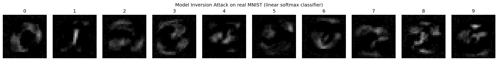

# Recreating a Model Inversion Attack on Handwritten Digits

*A hands-on reproduction of Fredrikson et al.'s model inversion attack (CCS 2015), using the real MNIST dataset, a linear softmax classifier, and a from-scratch PyTorch implementation.*

---

## Why Model Inversion Matters

Machine learning models do not simply learn a mapping from inputs to labels.

During training, the parameters of a model absorb statistical information about the data used to train it. In some situations, this information can be exploited by an attacker.

This creates an important privacy question:

> **Can an attacker recover meaningful information about training data by querying a trained machine learning model?**

One class of attacks that explores this question is **model inversion**.

Fredrikson, Jha, and Ristenpart introduced model inversion attacks that exploit confidence information returned by a trained classifier. Their work demonstrated that an attacker can optimize an input toward a target class and reconstruct a representative example of that class without directly accessing the original training data.

The key idea is surprisingly simple:

> **Instead of changing the model parameters, change the input.**

The model is kept frozen. The attacker treats the input itself as the optimization variable and searches for an input that maximizes the model's confidence for a chosen target class.

---

# Background

In ordinary machine learning training, the process looks roughly like this:

```text
Training data
     ↓
Machine learning model
     ↓
Optimization
     ↓
Learned model parameters
     ↓
Predictions
```

In model inversion, the direction is different.

The attacker already has the trained model and instead searches for an input that produces a desired prediction:

```text
Frozen trained model
        ↓
Choose target class
        ↓
Initialize input
        ↓
Calculate model confidence
        ↓
Calculate gradient with respect to input
        ↓
Update input pixels
        ↓
Repeat
        ↓
Reconstructed class prototype
```

The important distinction is that **the model weights are not being updated**.

Only the pixels of the synthetic input are optimized.

---

# What I Changed

The original Fredrikson et al. work focused on settings where model inversion could reveal sensitive information about individual identities.

Instead of reproducing the original experimental setup exactly, I built a smaller and more transparent experiment.

The experiment uses:

* The real MNIST handwritten digit dataset
* A linear softmax classifier
* PyTorch
* A from-scratch gradient-ascent attack
* 28 × 28 grayscale input images
* Ten target classes corresponding to digits 0–9

This makes it easier to understand exactly what the attack is doing.

---

## Dataset

I used the standard **MNIST handwritten digit dataset**.

The dataset contains:

* **60,000 training images**
* **10,000 test images**
* **28 × 28 pixel resolution**
* **10 classes**
* Digits **0 through 9**
* **784 input values** per image

Each image is converted from a 28 × 28 matrix into a vector containing 784 pixel values.

Conceptually:

```text
28 × 28 image
      ↓
Flatten
      ↓
784-dimensional vector
```

The attack does not directly use individual MNIST images during reconstruction.

Instead, it uses the trained classifier.

---

# Model

The target classifier is intentionally simple.

It consists of a single fully connected layer:

```text
784 input pixels
       ↓
Linear layer
nn.Linear(784, 10)
       ↓
10 class logits
       ↓
Softmax
       ↓
Digit probabilities
```

There are no convolutional layers and no hidden layers.

The model therefore has substantially less representational capacity than a typical CNN used for MNIST classification.

This is useful because it allows us to study the model inversion mechanism without introducing unnecessary architectural complexity.

---

# Training the Target Model

The model was trained for **5 epochs** using plain stochastic gradient descent.

The resulting test accuracy was:

**91.79%**

This is considerably lower than the approximately 98–99% accuracy commonly achieved by convolutional neural networks on MNIST.

That difference is expected.

A linear classifier does not explicitly model local spatial relationships between neighboring pixels. It therefore has a much weaker representation of handwritten digit structure.

However, the important question is:

> **Does a weak linear classifier still contain enough information for model inversion?**

The experiment shows that it does.

---

# The Model Inversion Attack

After training, the model parameters are frozen.

For each target digit class `c`, I initialize an artificial image.

The initial image contains no real handwritten digit.

The attacker then optimizes this image so that the trained classifier becomes increasingly confident that the image belongs to the selected target class.

The optimization is performed directly over the pixels.

---

## Attack Objective

For a target class `c`, the attack maximizes the target class probability.

In implementation, I optimize the negative log-probability together with a small L2 regularization term:

```text
loss =
    -log_softmax(model(x))[c]
    + l2 * ||x||²
```

The optimization can be viewed as:

```text
Initialize x
    ↓
Forward pass through frozen model
    ↓
Calculate target-class log probability
    ↓
Calculate gradient with respect to x
    ↓
Update x
    ↓
Clip pixel values to [0, 1]
    ↓
Repeat
```

The important detail is:

```text
model weights → FROZEN
input pixels  → UPDATED
```

---

# Why Optimize the Input?

Normally, gradients are used to update model parameters.

For example:

```text
Training:

input → model → loss
          ↓
      update weights
```

Model inversion reverses this relationship:

```text
model weights → frozen

input → model → target confidence
  ↑
update input pixels
```

The gradient tells the attacker how changing each pixel affects the model's confidence in the selected class.

After enough iterations, the input begins to resemble a prototype of the target class.

---

# Attack Configuration

For every digit from **0 to 9**, I performed:

* 2,000 optimization iterations
* Gradient-based optimization
* Pixel values constrained to `[0, 1]`
* Small L2 regularization
* Frozen classifier parameters
* Independent reconstruction for each target class

The attacker therefore generates ten reconstructed images:

```text
Target 0 → reconstructed 0
Target 1 → reconstructed 1
Target 2 → reconstructed 2
...
Target 9 → reconstructed 9
```

---

# Results

The following figure shows the reconstructed images generated entirely from the trained model.

The attacker does not use a real MNIST image as the reconstruction target.



*Figure 1. Model inversion results for all ten MNIST classes. Each image is reconstructed by optimizing the input pixels against the frozen linear classifier.*

---

## What Do the Reconstructions Show?

The results are not equally recognizable for every digit.

Some classes show clear coarse structure.

For example:

### Digit 0

The reconstruction contains a visible ring-like structure.

This is consistent with the broad shape expected for a handwritten zero.

### Digit 1

The reconstruction contains a strong vertical component.

Again, this corresponds to the characteristic structure of the digit.

### Other digits

Several other reconstructions are considerably noisier.

They contain visible patterns associated with the target class, but they are harder to identify immediately as a specific handwritten digit.

This difference is important.

Model inversion does not necessarily produce a clean photograph-like reconstruction.

What it reveals is the type of information encoded by the model's learned decision boundary.

---

# A Class Prototype — Not a Training Example

One of the most important observations from this experiment is that the reconstruction should **not** be interpreted as recovery of a specific MNIST training image.

MNIST contains many different examples of each digit.

For example, the training set contains thousands of different handwritten versions of digit `7`.

Therefore, when the attacker asks:

```text
"What does the model think a 7 should look like?"
```

the optimization is not necessarily going to recover one particular training image.

Instead, it tends toward a representation that strongly activates the classifier for class `7`.

The result is better interpreted as a:

> **class prototype**

rather than:

> **recovered training sample**

This distinction is particularly important when discussing privacy.

---

# Why the Attack Is Possible

The attack depends heavily on the information exposed by the model.

Suppose an API returns only:

```text
Prediction: 7
```

The attacker receives relatively little information.

But suppose the API returns:

```text
0 → 0.001
1 → 0.002
2 → 0.003
...
7 → 0.91
...
```

Now the attacker has considerably more information about how the model responds to changes in the input.

Those confidence values provide a much stronger optimization signal.

This is why confidence information can become a privacy concern.

---

# The Role of Confidence Scores

The attack exploits the fact that the classifier exposes real-valued confidence information.

Conceptually:

```text
Input image
     ↓
Frozen classifier
     ↓
Class probabilities
     ↓
Target-class confidence
     ↓
Gradient signal
     ↓
Modify input
     ↓
Higher target confidence
```

The process repeats until the generated input becomes strongly associated with the target class.

Therefore, an important security lesson is:

> **The output interface of a machine learning model can affect its privacy risk.**

The model itself may remain unchanged, while exposing more detailed prediction information can make certain attacks substantially easier.

---

# Why the Linear Model Is Interesting

At first glance, a linear classifier may seem too simple for a meaningful privacy experiment.

However, its simplicity is actually useful.

The classifier has the form:

```text
z = Wx + b
```

where:

* `x` is the input image
* `W` is the learned weight matrix
* `b` is the bias
* `z` contains the class logits

The probability distribution is then obtained through softmax:

```text
p(y=c | x) = softmax(Wx + b)c
```

Because the model is linear before the softmax operation, the relationship between the input and the class logits is straightforward.

The gradient with respect to the input can therefore be calculated directly.

There is no deep network with many nonlinear layers to traverse.

---

# Why the Reconstructions Are Noisy

An interesting result from this experiment is that the reconstructed images are relatively noisy.

There are several possible explanations.

## 1. High-dimensional input

MNIST contains:

```text
28 × 28 = 784
```

input dimensions.

The optimizer therefore has 784 independent pixel dimensions it can manipulate.

Without an explicit image prior or strong spatial regularization, the optimization can exploit unusual pixel configurations that increase the target class score.

---

## 2. Limited model accuracy

The classifier achieves:

**91.79% test accuracy**

This is substantially lower than a typical MNIST CNN.

The learned decision boundary therefore provides a less accurate representation of the true distribution of handwritten digits.

When the attacker optimizes against this decision boundary, the resulting prototype can inherit those weaknesses.

---

## 3. No convolutional inductive bias

CNNs naturally exploit local spatial relationships.

A linear classifier does not.

For example, a CNN can learn useful structures such as:

```text
edges
 ↓
strokes
 ↓
curves
 ↓
digit parts
 ↓
complete digit
```

The linear model does not build such a hierarchy.

Consequently, its inversion results can contain less natural spatial structure.

---

# Comparison With a CNN

The model used here is deliberately weaker than the CNN-based implementation described in related practical demonstrations.

The difference can be summarized as:

| Property          | Linear Model              | CNN                         |
| ----------------- | ------------------------- | --------------------------- |
| Architecture      | Single linear layer       | Multiple nonlinear layers   |
| Spatial structure | Weak                      | Strong                      |
| MNIST accuracy    | 91.79% in this experiment | Typically much higher       |
| Inversion surface | Relatively simple         | More complex                |
| Reconstruction    | Noisier                   | Potentially more structured |
| Computation       | Cheap                     | More expensive              |

The purpose of this experiment is not to claim that the linear model produces a stronger attack.

Instead, it demonstrates that the fundamental inversion mechanism can still operate even with a very simple classifier.

---

# An Important Privacy Limitation

The MNIST experiment is useful for demonstrating the mechanism, but it should not be interpreted as equivalent to an identity-recovery attack.

The reason is the class structure.

For MNIST:

```text
class 0 → many different people writing 0
class 1 → many different people writing 1
...
class 9 → many different people writing 9
```

The target class therefore represents a large population of examples.

In contrast, in an identity classification scenario:

```text
class A → person A
class B → person B
class C → person C
```

If the model learns one class per individual, reconstructing the class prototype can reveal much more directly identifiable information.

This is why the privacy implications of model inversion depend strongly on:

* The dataset
* The class definition
* The model architecture
* The information exposed by the API
* The attacker's query access
* The regularization and optimization strategy

---

# What This Experiment Actually Demonstrates

The experiment demonstrates three important ideas.

### 1. Model parameters contain information

The classifier's parameters encode statistical structure learned from MNIST.

The attacker does not need direct access to the original training images to obtain a meaningful signal.

### 2. Inputs can be optimized against a frozen model

The attacker does not need to retrain the classifier.

Instead:

```text
Freeze model
    ↓
Optimize input
    ↓
Increase target confidence
    ↓
Recover class prototype
```

### 3. Confidence information can increase attack capability

A richer output interface gives the attacker more information about the model's behavior.

This makes confidence scores an important consideration in privacy-sensitive ML systems.

---

# Potential Countermeasures

Fredrikson et al. discussed several approaches for reducing the usefulness of confidence information.

Possible defenses include:

### Return only the predicted class

Instead of returning the complete probability vector:

```text
[0.01, 0.02, ..., 0.91, ...]
```

the API can return only:

```text
Prediction: 7
```

This removes much of the continuous confidence information.

---

### Round confidence values

Instead of exposing highly precise probabilities:

```text
0.91372841
```

an API could expose a less precise value.

For example:

```text
0.9
```

Reducing precision can make optimization less informative.

---

### Add carefully calibrated noise

Noise can also reduce the reliability of the signal available to an attacker.

However, privacy protection should be designed carefully because excessive noise can also reduce legitimate model utility.

---

# Security Perspective

The most important lesson is not that MNIST digits can be reconstructed.

The broader lesson is:

> **A trained machine learning model can contain information about the data used to train it, and the model's prediction interface determines how much of that information an external party can exploit.**

This becomes particularly important for deployed machine learning APIs.

A system designer should therefore consider not only:

```text
How accurate is my model?
```

but also:

```text
What information does my model reveal?
```

---

# Reproducibility

This experiment was implemented using:

* Python
* PyTorch
* MNIST
* Gradient-based optimization
* A linear `nn.Linear(784, 10)` classifier

The attack was implemented directly rather than relying on an external model inversion library.

This makes the experiment useful as a small educational reproduction of the underlying mechanism.

---

# Key Takeaways

The main conclusions from this experiment are:

1. **Model inversion can work even against a simple linear classifier.**
2. **The reconstruction represents a class prototype rather than necessarily recovering an individual training example.**
3. **The 784-dimensional MNIST input gives the optimizer substantial freedom to produce noisy solutions.**
4. **The relatively low 91.79% classifier accuracy contributes to weaker reconstructions compared with stronger classifiers.**
5. **Linear models are particularly straightforward to analyze because their gradients with respect to the input are easy to compute.**
6. **Confidence scores provide useful information to an attacker.**
7. **Returning only hard labels, reducing confidence precision, or adding appropriate noise can reduce the information available to this type of attack.**
8. **The privacy implications become substantially more significant when individual identities correspond directly to model classes.**

---

# Final Takeaway

This experiment changed my perspective on what it means for a model to "forget" its training data.

A model does not simply store a dataset in an obvious database-like form. Instead, training transforms the data into parameters that define a decision function.

Yet those parameters can still reveal structure about the original training distribution.

In this experiment, a simple linear classifier trained on MNIST was enough to produce recognizable class-level structures when its input was optimized against the frozen model.

The reconstructed images are imperfect and noisy, but that is precisely what makes the experiment interesting.

The attacker never asks:

> "Give me the training image."

Instead, the attacker asks the model:

> "What input would make you most confident that this belongs to class `c`?"

The answer is encoded in the model's own decision boundary.

That is the core privacy insight behind model inversion.

---

# References

1. Fredrikson, M., Jha, S., & Ristenpart, T. (2015). *Model Inversion Attacks that Exploit Confidence Information and Basic Countermeasures*. Proceedings of the 22nd ACM SIGSAC Conference on Computer and Communications Security (CCS).

2. Boenisch, F. (2020). *Attacks against Machine Learning Privacy (Part 1): Model Inversion Attacks with the IBM-ART Framework.*

3. Boenisch, F. (2021). *Attacks against Machine Learning Privacy (Part 2): Membership Inference Attacks with TensorFlow Privacy.*

---

## Experiment Summary

```text
Dataset
MNIST
60,000 training images
10,000 test images
28 × 28 pixels

        ↓

Target Model
Linear Softmax Classifier
nn.Linear(784, 10)

        ↓

Training
5 epochs
SGD
91.79% test accuracy

        ↓

Model Inversion
10 target classes
2,000 iterations per class
Input pixels optimized
Model weights frozen

        ↓

Output
10 reconstructed class prototypes

        ↓

Observation
Recognizable coarse structures
but noisy reconstructions

        ↓

Privacy Insight
Model parameters + confidence information
can reveal information about training distribution
```
